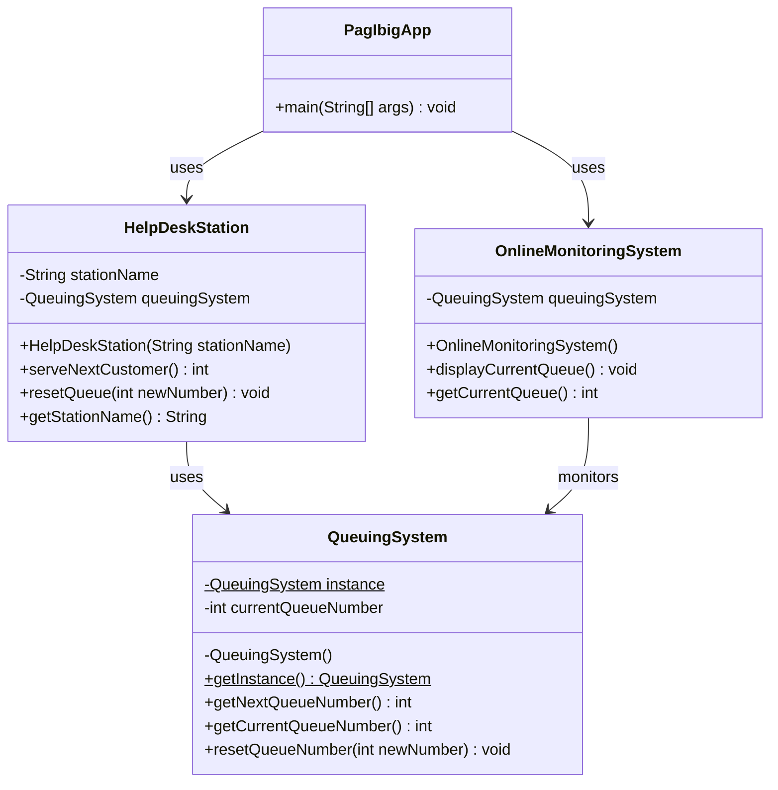

# Centralized Queuing System for Pag-ibig Office

The Pag-ibig office implements a centralized queuing system for three help desk stations. Individuals visiting the office obtain a queue number from this centralized system. Additionally, there's an online monitoring system that displays the current queued number in real-time for individuals monitoring the queue remotely.

Each help desk station has an option to reset the queuing number based on an inputted number, allowing flexibility in managing the queue during specific situations, such as reorganization or technical issues. This queuing system ensures a single centralized queue number for all help desk stations, while the reset option offers control and adjustment in exceptional circumstances.

This approach aims to maintain an organized queuing process for individuals visiting the office and provides the flexibility to handle queue adjustments as needed.

## Class Definitions

- **QueuingSystem**: The Singleton class responsible for maintaining and managing the centralized queue state. It guarantees that only one instance of the queue exists across all help desk stations and monitoring clients.
- **HelpDeskStation**: Represents a customer service station at the office. Obtains the centralized `QueuingSystem` singleton instance to call/serve the next queue number or reset the queue when adjustments are required.
- **OnlineMonitoringSystem**: Represents the real-time remote monitoring system that queries the centralized `QueuingSystem` to display the active queue number.
- **PagIbigApp**: The main driver class that demonstrates the workflow of three help desk stations, real-time online monitoring, queue resets, and singleton verification.

## UML Class Diagram

